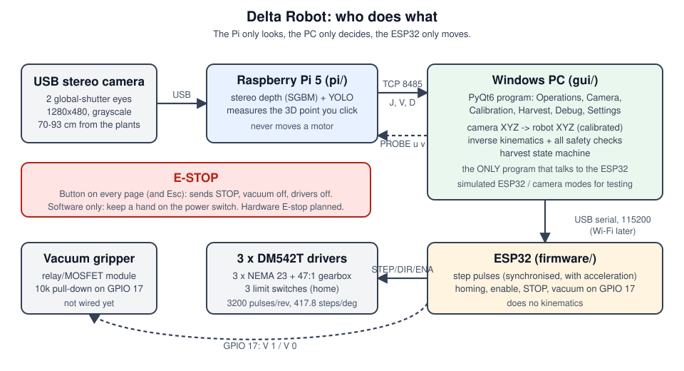

# Delta Robot — strawberry-harvesting delta robot

A 3-armed **delta robot** that finds strawberries with a depth camera and a YOLO neural network and picks them with a vacuum gripper.
This folder holds everything: the **PC control program** (`gui/`), the **Raspberry Pi vision server** (`pi/`) and the **ESP32 motor firmware** (`firmware/`).

> **Status: built and tested in simulation. Not yet run on the real robot.** Everything below says what is finished, what is only tested on a computer, and what is still missing.
> The motors are NEMA 23 with 47:1 gearboxes and can hurt you: read [Safety](#safety-read-first) before powering anything.



**The rule that keeps it simple and safe: the Pi only looks, the PC only decides, the ESP32 only moves.**
Only the PC talks to the ESP32; the Pi never sends motor commands.

## Start here (no robot needed)
You can try the whole program with **simulated hardware** on any PC. Nothing real can move.
```
cd Delta_Robot
python -m venv venv && venv\Scripts\activate          # Windows  (Linux/macOS: source venv/bin/activate)
pip install -r gui/requirements.txt
python gui/Delta_Robot_GUI.py --sim-esp32
```
1. Press **Connect** (top right; "Simulated ESP32" is ticked), then **Enable motors**, then **HOME**.
2. On **Operations**, move to an XYZ point or jog. On **Camera**, tick *Simulated camera (test mode)* and Connect to see fake detections.
3. Press the red **EMERGENCY STOP** (or Esc) to see what a stop does. It is on every page.

Screenshots: `docs/screenshots/`. Page-by-page help: [docs/GUI.md](docs/GUI.md).

## What is where
```
Delta_Robot/
├── README.md, CLAUDE.md, .gitignore     this file; notes for AI assistants; keeps secrets/weights/datasets out of git
├── gui/                  PC program (PyQt6)
│   ├── Delta_Robot_GUI.py        start this
│   ├── delta_gui/core/           NO Qt: kinematics, robot controller (ALL motion safety), link (serial + simulated ESP32),
│   │                             settings, calibration maths, harvest state machine
│   ├── delta_gui/ui/             Qt: theme, main window, pages (operations, camera, calibration, harvest, debug, settings), wizards
│   ├── camera_client.py          reads the Pi's stream (video, depth, detections) and sends PROBE requests
│   ├── tests/                    automated tests, no hardware needed
│   └── Delta_Robot_GUI_tkinter.py  the previous Tkinter GUI, kept until the new one is proven on the real machine
├── pi/                   Raspberry Pi vision server
│   ├── pi_camera_server.py       capture -> stereo depth -> YOLO -> stream (protocol documented at the top)
│   ├── config.yaml               camera, depth range, YOLO model + allowed classes, ports
│   ├── calibrate_stereo.py, calib_capture.py, make_checkerboard.py   stereo calibration tools
│   ├── camera_check.py, tof/     camera diagnostics (ToF tools only if a ToF camera ever appears)
│   ├── fake_camera.py, tests/    pretend camera + self-tests
│   └── delta-vision.service, install_service.sh   run at boot (you run the installer yourself; it uses sudo)
├── firmware/             ESP32
│   ├── Delta_Robot_ESP32/Delta_Robot_ESP32.ino   version 2: acceleration, vacuum, safer homing (NOT flashed yet)
│   └── tests/                    compiles the real firmware on a PC with a fake Arduino core and tests it
├── docs/                 documentation (index below), screenshots/, architecture.svg
└── archive/              the original files this work started from, untouched
```

## Documentation
| Read this | When |
|---|---|
| [docs/GUI.md](docs/GUI.md) | using the control program, page by page |
| [docs/CALIBRATION.md](docs/CALIBRATION.md) | **before any real picking**: stereo, robot geometry/home, camera -> robot |
| [docs/PI_SETUP.md](docs/PI_SETUP.md), [pi/README.md](pi/README.md) | setting up and running the Raspberry Pi |
| [docs/FIRMWARE.md](docs/FIRMWARE.md) | what the ESP32 firmware does, tuning, **how to flash and bench-test it** |
| [docs/PROTOCOL.md](docs/PROTOCOL.md) | the two text/binary protocols (PC <-> ESP32, Pi -> PC) |
| [docs/WIRING.md](docs/WIRING.md) | which ESP32 pin goes where (check against the real wiring) |
| [docs/HARVEST.md](docs/HARVEST.md), [docs/HARVEST_SIM_LOG.txt](docs/HARVEST_SIM_LOG.txt) | how automatic picking decides and stops; a full simulated run |
| [docs/YOLO_TRAINING.md](docs/YOLO_TRAINING.md) | collecting pictures, labelling, training on Colab, putting the model on the Pi |
| [docs/TROUBLESHOOTING.md](docs/TROUBLESHOOTING.md) | symptom -> cause -> fix |
| [docs/LICENSES.md](docs/LICENSES.md) | Ultralytics AGPL-3.0, PyQt6 GPL-3.0 and other licences; the open licence decision |
| [docs/PHASE1_REVIEW.md](docs/PHASE1_REVIEW.md) | the bugs and risks found in the original code |

## Status: what works and what does not
| Part | State |
|---|---|
| PC GUI (6 pages, E-STOP everywhere, settings file, simulated ESP32 + camera) | **Built, tested offscreen with simulated hardware.** Never run on the real robot. A layout bug seen on a real PC (squashed Settings page) was found and fixed. |
| Robot controller safety (workspace box, unreachable/limit checks, busy flag, position-valid, latched E-STOP, timeouts) | Tested against a simulated ESP32 that reproduces the old firmware's quirks. |
| Pi vision server: stereo depth, streaming, calibration tools | **Run on the real Pi and camera**: calibrated (RMS 0.39 px, baseline 62.2 mm), streaming to the GUI at about 6 fps, ruler check passed. Speed not tuned. |
| YOLO detection | Code and tests exist; **ultralytics is not installed on the Pi and no strawberry model exists.** |
| Calibration wizards (home angles, camera -> robot) | Tested in simulation with known answers. Not yet used on the real robot. |
| Automatic picking | Tested in simulation (dry run by default). Refuses a model without a strawberry class. Never moved the real robot. |
| ESP32 firmware v2 | Written and passes 53 PC tests. **Not flashed.** The robot still runs (or would run) the original firmware. |
| Vacuum gripper | Firmware support on GPIO 17 (active HIGH); hardware not built or wired. |
| Hardware E-stop | Planned. Today's E-STOP is software only. |
| Colour / ripeness | Not possible: the camera is grayscale. |

**Unverified numbers** (measure before trusting): effector radius 50 mm, arm lengths 150 / 280 mm, base radius 76.2 mm, arm-angle limits -30..80 degrees, step rate 4000/s,
acceleration, homing back-off, harvest grasp offset and drop point. DM542T microstepping (3200 pulses/rev) is from the standard table: check the driver label.

## Safety — read first
* **Keep your hand on the motor power switch** whenever the robot can move. The GUI's EMERGENCY STOP is a **software** stop (sends `STOP`, vacuum off, then drivers off). If the cable, PC or ESP32 hangs it
  stops nothing. A hardware E-stop that cuts driver power is planned and strongly recommended.
* **Never press HOME or start picking until you can cut power.** Homing is unvalidated on this machine; the homing direction was changed by trial in the original.
* "Disable motors" and the E-STOP's driver-off let the arms **sag or fall**.
* After any manual/raw move, reset or lost reply the GUI marks the position **unknown** and refuses XYZ moves until you home. Keep it that way.
* Automatic picking only targets detections of an **allowed strawberry class**, only with valid calibrations, and refuses stock YOLO (it sees people, not berries). It asks before every run and defaults to a dry run (no vacuum).
* Do not flash the ESP32 with the robot powered. See [docs/FIRMWARE.md](docs/FIRMWARE.md).

## Running the real system (in this order)
1. **Pi:** [docs/PI_SETUP.md](docs/PI_SETUP.md) -> `python pi_camera_server.py` -> check `http://<pi-ip>:5000`.
2. **Stereo calibration:** [docs/CALIBRATION.md](docs/CALIBRATION.md) section 1.
3. **ESP32:** read [docs/FIRMWARE.md](docs/FIRMWARE.md); flash with motor power OFF; bench-test; then low-speed moves with a hand on the power switch.
4. **GUI -> Calibration:** geometry, home wizard, camera -> robot wizard.
5. **YOLO:** [docs/YOLO_TRAINING.md](docs/YOLO_TRAINING.md); enable detection on the Pi.
6. **Harvest page:** dry run first; vacuum only after the vacuum hardware and firmware are in place.

## Running the tests (no hardware needed)
```
cd pi  && python tests/test_server_fake.py      # and the other files in pi/tests
cd gui && python tests/test_core_robot.py       # and the other files in gui/tests (the GUI tests need PyQt6)
sh firmware/tests/run_tests.sh                  # needs g++
```
Each prints `ALL TESTS PASSED` when it is happy.

## Words you will meet
**Delta robot:** three arms joined to one small platform (the effector); moving the arms together moves the platform in X, Y, Z. **Inverse kinematics (IK):** from a wanted XYZ to the three arm angles.
**Forward kinematics (FK):** the other way round. **Steps:** a stepper motor moves in small steps; here 417.78 steps = 1 degree of arm. **Stereo depth:** two cameras a known distance apart; the shift (disparity) of a point
between them gives its distance. **Calibration:** measuring the camera and robot so pixels and steps turn into millimetres. **Homing:** driving the arms to the limit switches so the robot knows where it is.
**Dry run:** doing all the moves without the vacuum. **E-STOP:** emergency stop.

## Credits and licences
Built from the `greatroboticslab/deltarobot` GUI, camera client, Pi server and firmware (kept in `archive/`). Uses Ultralytics YOLO (**AGPL-3.0**), PyQt6 (**GPL-3.0**), NumPy, OpenCV, PyYAML and pyserial.
**This project has no licence yet** — see [docs/LICENSES.md](docs/LICENSES.md) for what is required and the choice to make. *(Not legal advice.)*
