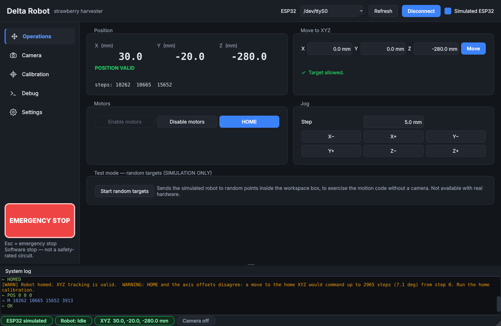

# The control program (PyQt6)

Run it on the Windows PC:

```
cd Delta_Robot\gui
pip install -r requirements.txt
python Delta_Robot_GUI.py                 # normal
python Delta_Robot_GUI.py --sim-esp32     # start in simulation: a fake ESP32, nothing real can move
```

**First time: try it in simulation.** Tick "Simulated ESP32" in the top bar, press Connect, Enable motors, HOME and move around. Tick
"Simulated camera (test mode)" on the Camera page to see the camera screen working with no Pi. Only then connect the real ESP32.



*(All screenshots here are from the simulated ESP32 and the simulated camera: the camera pictures are a test pattern, not a real scene.)*

## The screens

| Page | What it is for |
|---|---|
| **Operations** | Where the robot is (X, Y, Z and whether that position can be trusted), move to an XYZ, jog, enable/disable the motors, HOME. Every button is enabled only when the robot would accept the command, and the page says why when it would not. In simulation only: an explicit *random targets* test mode (the old "camera tracking" random generator). |
| **Camera** | Live video with boxes and labels (class, confidence, camera XYZ, robot XYZ), the colourised depth picture, a table of detections, the *effector crosshair* (where the robot's tip appears in the picture), and **Move above selected**. Address of the Pi, simulated-camera switch. |
| **Calibration** | The physical machine: geometry as **radii**, motor steps × microsteps × gearbox as three fields, axis offsets and directions, arm-angle limits, home position (with a consistency check), the workspace box (with a "whole box reachable?" check), and the camera-to-robot calibration status. Nothing applies until *Apply and save*. |
| **Debug** | Raw motor control (absolute steps / jog by steps), *set current position as home (Z)*, *query position*, *recover position from steps*, and the serial traffic. |
| **Settings** | Safety behaviour (what E-STOP does, confirmations, time limits), motion limits (tip speed, step rate), baud rate, the settings file. |

The **top bar** holds the ESP32 connection (port, Connect, simulation switch). The **sidebar** holds the page buttons and, below them, the
large red **EMERGENCY STOP** — it is on screen on every page, and **Esc** triggers it from anywhere. The **status bar** shows the ESP32, the
robot state, the current XYZ and the camera. The **system log** at the bottom shows what happened, including every command and reply.

## Safety rules the program enforces

All motion safety lives in `delta_gui/core/robot.py` (no GUI code), and is tested without hardware.

Kept from the original program: the workspace box, the "unreachable" check, the busy flag, the position-invalid flag after raw moves, E-STOP.
New, from the code review:

* **One command at a time, and every reply is matched to its command.** The firmware answers `OK` both to a finished move and to `EN`;
  matching replies to commands removes the confusion that let the old GUI lose track of whether the robot was busy.
* **The position is UNKNOWN until you HOME** (or use *set current position as home*), and again after: a stop, any error, an unexpected
  ESP32 reset, a lost link, a reply that never came, switching the drivers off, or changing the geometry. XYZ moves are refused meanwhile.
* **Moves are refused unless the motors are enabled** (the firmware would happily "move" its counters with the drivers off).
* **Arm-angle limits** are checked in addition to the workspace box.
* **A maximum step rate** also sets how long a move takes (the firmware has no acceleration yet).
* **E-STOP is latched.** It sends STOP at once, then (setting) switches the drivers off. Nothing moves until you release it, and the
  position is unknown afterwards. Even homing can be stopped, because the firmware checks for STOP while homing.
* **Confirmations** before homing, before disabling the motors, before a large raw move, before setting the position as home and before
  *Move above selected*.
* **Automatic motion from the camera may only target allowed (strawberry) classes**, only with a calibrated stereo camera and a
  camera-to-robot calibration. "Move above selected" refuses anything else and says why.
* The random-target test mode exists **only** with the simulated ESP32.

> The E-STOP button is a *software* stop. If the cable, the PC or the ESP32 hangs it cannot stop anything. Keep a hand on the motor power
> switch; a hardware E-stop that cuts driver power is planned.

## Things that are different from the old Tkinter program

* **Geometry is entered as radii** (centre → motor axis, centre → effector joints), not triangle side lengths. The old program's `f` and `e`
  were side lengths even though people read them as radii; typing a 3-inch radius there put the shoulder joint 3.5× too close to the
  centre and changed the computed arm angles by about 12°. The Calibration page shows the side lengths the formulas actually use.
* **Steps per revolution = motor full steps × microsteps × gearbox ratio**, three separate fields (default 200 × 16 × 47 = 150,400).
* After connecting you must **enable the motors and HOME** (or deliberately set the current position as home) before XYZ moves are allowed.
  The old program assumed a valid position from the start.
* Disabling the motors, E-STOP, errors and resets all make the position unknown, so the next XYZ move needs a HOME.
* Default workspace box is **±100 × ±100 mm, Z −350…−210 mm**, which is entirely reachable with the default arm lengths. (The old larger box
  was not.) Arm lengths, effector radius and the arm-angle limits are **unverified**: measure them and set them.

## Settings file

Everything you set — geometry, offsets, workspace, safety options, camera address, calibration — is saved to one file that loads at
start-up: `%USERPROFILE%\.delta_robot\settings.json` (set the environment variable `DELTA_ROBOT_SETTINGS` to use another file). It is
written atomically; an unreadable file is renamed `settings.broken` and the defaults are used, so the program always starts.

## Layout of the code

```
gui/
  Delta_Robot_GUI.py          entry point (short)
  camera_client.py            the stream from the Pi (reconnects, bounded queue, no GUI toolkit)
  camera_overlay.py           drawing of boxes / labels / crosshair
  delta_gui/core/             robot logic, no GUI: kinematics.py  link.py  robot.py  settings.py  transform.py
  delta_gui/ui/               theme.py icons.py widgets.py context.py camera_controller.py main_window.py pages/*.py
  tests/                      automated tests (see below)
  Delta_Robot_GUI_tkinter.py  the previous program, kept until this one has been checked on your PC
```

`link.py` contains both the real serial link and **`SimulatedESP32Link`**, a fake ESP32 that reproduces the firmware's behaviour *including its
quirks* (the ambiguous `OK`, homing that swallows other commands, `Z` accepted while moving), so the safety logic is tested against realistic behaviour.

## Tests (no hardware, no screen needed)

| File | What it proves |
|---|---|
| `tests/test_core_robot.py` | the safety controller against the simulated ESP32: every refusal, reply matching, E-STOP (mid-move and mid-homing), lost reply, brown-out reset, link loss, step-rate limit, home consistency, position recovery |
| `tests/test_core_misc.py` | kinematics (inverse ↔ forward to 1e-6 mm), radius↔side conversion, Kabsch camera→robot solver, settings file, the real serial link through a loopback port |
| `tests/test_gui_qt.py` | the whole GUI offscreen: E-STOP on every page, Esc key, a full simulated session, thread safety, camera path with detections, "Move above selected" refusals, calibration page, settings persistence, a pixel check that number boxes draw |
| `tests/make_screenshots.py` | regenerates the screenshots in `docs/screenshots/` |

## Not verified yet

The GUI has been run only offscreen on a Linux test machine with simulated hardware. **Not yet checked: on your Windows screen, with the real
ESP32, with the real camera stream through this new window.** The first thing to do on your PC is run it in simulation, then connect the real
ESP32 with the motors' power switch within reach and do nothing but *Enable* and look at the log.
